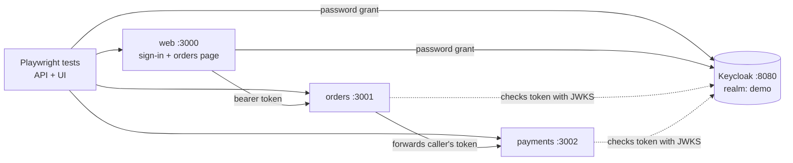

# ai-qa-harness

An AI-assisted QA harness, built in public.

This project shows how to use Claude to write Playwright tests. It also shows how to prove that those tests are good.
The project tests a small demo shop. The shop has two services and a web page. Keycloak controls sign-in.

> **Status:** Stage 1 of 6. The demo system, the hand-written tests and CI are in place. The AI parts come next. See [Roadmap](#roadmap).

## Architecture



| Part | What it does |
| --- | --- |
| `services/web` | Shows a sign-in page and an orders page. It keeps the user's token on the server. |
| `services/orders` | Creates and lists orders. It sends each order to payments. Users see only their own orders. |
| `services/payments` | Approves a payment up to $1,000. It declines larger payments. |
| `keycloak/` | The demo realm. It has one client and two test users. |
| `services/mock-idp` | A small stand-in for Keycloak. Use it only when Docker is not available. |
| `tests/` | Playwright TypeScript tests for the API and the UI. |

All services use TypeScript, Node.js 22 and Express. They keep data in memory.

## Run it

### What you need

- Node.js 22 or later.
- Docker, to run Keycloak. Without Docker, use the mock (see below).

### With Keycloak

1. Install the dependencies.
   ```bash
   npm install
   npx playwright install chromium
   ```
2. Start Keycloak. Wait about 30 seconds for the first start.
   ```bash
   npm run keycloak:up
   ```
3. Run the tests. Playwright starts the three services for you.
   ```bash
   npm test
   ```
4. Open the test report.
   ```bash
   npm run report
   ```
5. Stop Keycloak when you finish.
   ```bash
   npm run keycloak:down
   ```

### Without Docker

Run the tests with the mock identity provider:

```bash
npm run test:mock
```

The mock copies only the Keycloak endpoints that this demo uses. CI runs the tests against both.

### Use the shop yourself

1. Start Keycloak, or start the mock with `npm run start:mock-idp`.
2. Start each service in its own terminal: `npm run start:payments`, `npm run start:orders`, `npm run start:web`.
3. Open http://localhost:3000.
4. Sign in as a test user.

| User | Password |
| --- | --- |
| `alice` | `alice-pass` |
| `bob` | `bob-pass` |

These are demo credentials for a local test realm. Do not use them anywhere else.

## Tests

| Suite | File | What it checks |
| --- | --- | --- |
| API | `tests/api/orders.api.spec.ts` | Token checks, order totals, payment decline, input checks, access between users. |
| API | `tests/api/payments.api.spec.ts` | Token checks, the $1,000 limit edge, input checks, access between users. |
| UI | `tests/ui/orders.ui.spec.ts` | Sign-in, wrong password, sign-out, placing orders, access between users. |

Useful commands:

```bash
npm run test:api     # API tests only
npm run test:ui      # UI tests only
npx playwright test --ui   # step through tests in Playwright's UI mode
```

## CI

GitHub Actions runs [`.github/workflows/ci.yml`](.github/workflows/ci.yml):

- On every pull request and every push to `main`.
- Every night at 03:00 Melbourne time (16:00 UTC).
- By hand, from the **Actions** tab.

Each run tests against real Keycloak and against the mock. Each run uploads the HTML report as an artifact.

## Roadmap

| Stage | Work | Status |
| --- | --- | --- |
| 1 | Demo services, Keycloak, Playwright project, CI | ✅ Done |
| 2 | Planted bugs, so the harness has real defects to find | Next |
| 3 | Claude writes tests from user stories and API specs. A mutation check proves each test can fail. | Planned |
| 4 | Pact contract tests between orders and payments. BDD features in Gherkin. | Planned |
| 5 | Results page on GitHub Pages: tests generated, review pass rate, mutation kill rate, bugs found | Planned |
| 6 | Write-up: how to trust tests that AI writes | Planned |

### The mutation check (stage 3)

AI can write many tests fast. Some of those tests can never fail. They give false confidence.
The harness changes each test's expected result and runs the test again. A good test must now fail.
If the changed test still passes, the harness flags it. The harness then reports a kill rate for the whole suite.

## About

Built by Mark Rotairo, a test automation engineer (ISTQB Advanced Test Automation Engineer).
I built everything in this repo from scratch for this public project.
